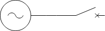
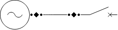

import Tabs from '@theme/Tabs';
import TabItem from '@theme/TabItem';

The EWB SDK provides the building blocks you need to interface with the rest of the EWB platform. It can also be used to
build your own solutions from scratch that will be compatible with other things built with the SDK.

## CIM Model

The EWB platform is composed around a domain model based on the 'Common Information Model' (CIM). The CIM is a very
large standard that covers a huge amount of use cases. To make things more digestible, Zepben publishes its own CIM
profile. CIM profiles are subsets of the whole CIM standard that dictates which parts of the model are in use. EWB
publishes its model at [https://zepben.github.io/evolve/docs/cim/ewb/](https://zepben.github.io/evolve/docs/cim/ewb/).

If the EWB profile doesn't contain a part of CIM that you require for your use case, you can request or propose a change to the model
by opening an issue on the [ewb-sdk-python GitHub issues](https://github.com/zepben/ewb-sdk-python/issues) or by contacting Zepben directly at \<https://www.zepben.com/\>.

## Getting Started With The Model

:::tip
All things that have an ID in the CIM model inherit from
[IdentifiedObject](https://zepben.github.io/evolve/docs/cim/cim100/TC57CIM/IEC61970/Base/Core/IdentifiedObject). This provides common
attributes such as mRID (master resource identifier), name, description, etc.
:::

Let's get started with the data model by building the following contrived electrical circuit.



Here we simply have an AC energy source ([EnergySource](https://zepben.github.io/evolve/docs/cim/ewb/IEC61970/Base/Wires/EnergySource/))
connected to a conductor ([ACLineSegment](https://zepben.github.io/evolve/docs/cim/ewb/IEC61970/Base/Wires/ACLineSegment/))
connected to a circuit breaker ([Breaker](https://zepben.github.io/evolve/docs/cim/ewb/IEC61970/Base/Wires/Breaker/)).
In CIM all these things are a subtype of 
[ConductingEquipment](https://zepben.github.io/evolve/docs/cim/ewb/IEC61970/Base/Core/ConductingEquipment/).

Let's see how we create them:

```python
from zepben.ewb import EnergySource, AcLineSegment, Breaker

# Create the energy source. An mRID is required when creating any object in the model.
source = EnergySource(mrid="source")

# Create the conductor with a specific mRID.
acls = AcLineSegment(mrid="aclineseg1")

# Create a circuit breaker with a descriptive name.
breaker = Breaker(mrid="breaker", name="my circuit breaker")
```

## Creating Connectivity

In CIM, all conducting equipment can have any number of [Terminals](https://zepben.github.io/evolve/docs/cim/ewb/IEC61970/Base/Core/Terminal/),
and terminals connect to other terminals using a [ConnectivityNode](https://zepben.github.io/evolve/docs/cim/ewb/IEC61970/Base/Core/ConnectivityNode/).
If we redraw the above diagram with all the required items from CIM it would look like:



Where the back dots represent the terminals and the black diamonds represent connectivity nodes.

Now, lets redo the above code sample this time also creating connectivity between the objects.

```python
from zepben.ewb import EnergySource, AcLineSegment, Terminal, Breaker, ConnectivityNode

# Create the energy source
source = EnergySource(mrid="source")

# Create the terminal for the energy source and associate it with the source
source_t1 = Terminal(mrid="source-t1", conducting_equipment=source)
source.add_terminal(source_t1)

# Create the conductor
acls = AcLineSegment(mrid="acls")

# Create a terminal for each end of the conductor
# and associate them with the conductor
acls_t1 = Terminal(mrid="acls-t1", conducting_equipment=acls)
acls_t2 = Terminal(mrid="acls-t2", conducting_equipment=acls)
acls.add_terminal(acls_t1)
acls.add_terminal(acls_t2)

# Create a circuit breaker
breaker = Breaker(mrid="breaker")

# Create a terminal for the breaker
breaker_t1 = Terminal(mrid="breaker-t1", conducting_equipment=breaker)

# Now create a connectivity node to connect the source terminal
# to the conductor's first terminal
cn1 = ConnectivityNode(mrid="cn1")

# Now associate the connectivity nodes to the terminals
cn1.add_terminal(source_t1)
source_t1.connectivity_node = cn1
cn1.add_terminal(acls_t1)
acls_t1.connectivity_node = cn1

# Now create a connectivity node to connect the conductor's second terminal
# to the breaker's terminal
cn2 = ConnectivityNode(mrid="cn2")

# Now associate the connectivity nodes to the terminals
cn2.add_terminal(acls_t2)
acls_t2.connectivity_node = cn2
cn2.add_terminal(breaker_t1)
breaker_t1.connectivity_node = cn2
```

## Normal and Current states

As the network is a dynamic model (that is things like switches can be open and closed), many things in the model support 
the notion of 'normal' and 'current'. For example, a switch has a normally open state and a currently open state. 
This allows you to perform analysis on the model considering the normal or current state of the network, and allows you 
to tell if the network is currently in the normal state or not. This can be important when making decisions based on 
analytics you may be running when using the model.

```python
from zepben.ewb import Breaker

# Example of setting normal and current switch states
switch = Breaker(mrid="switch")
switch.set_normally_open(True)
switch.set_open(False)
```

## Phases 

Phases in CIM are set on a [Terminal](https://zepben.github.io/evolve/docs/cim/ewb/IEC61970/Base/Core/Terminal). The `phases`
property on the terminal should be considered as the terminal's 'nominal' phases. The vast majority of the time, this will
be the actual active phases at that terminal. However, due to the dynamic nature of the network, it's possible that when
tracing connectivity that the active phase at the terminal is different. The traced phases are available as `PhaseStatus`
objects from the `normal_phases` and `current_phases` properties on the terminal, for the normal and current state of the
network respectively. A `PhaseStatus` can be indexed by nominal phase to see the phase traced for that phase, and
`as_phase_code()` will give a `PhaseCode` if the traced phases form a valid phase code (otherwise `None`).

:::tip
There are a number of helpful functions for tracing phases based on connectivity. See [tracing](tracing.mdx) for more
details, and [phases](phases.mdx) for the details of the phase fields available on a terminal.
:::

```python
from zepben.ewb import Terminal, PhaseCode

# Example of setting nominal phases on a terminal
terminal = Terminal(mrid="terminal", phases=PhaseCode.ABC)

# The traced phases for the normal and current state of the network (see phases.mdx).
# Nothing has been traced yet so both report PhaseCode.NONE.
print(f"{terminal}: nominal: {terminal.phases}, "
      f"normal: {terminal.normal_phases.as_phase_code()}, current: {terminal.current_phases.as_phase_code()}")
```

## Grouping equipment

In electricity distribution networks, a model is typically made up of groups of equipment that represent different
sections of the network. For example things like: feeder, zone (substation), transmission line etc. The terminology 
differs within the industry, however CIM provides types of 
[EquipmentContainer](https://zepben.github.io/evolve/docs/cim/ewb/IEC61970/Base/Core/EquipmentContainer) to allow you to
group equipment into the above types of categories. You can refer to the EWB CIM profile for all supported equipment
container types in the model, however the most common ones are:

- [Line](https://zepben.github.io/evolve/docs/cim/ewb/IEC61970/Base/Wires/Line/)
- [Substation](https://zepben.github.io/evolve/docs/cim/ewb/IEC61970/Base/Core/Substation/)
- [Feeder](https://zepben.github.io/evolve/docs/cim/ewb/IEC61970/Base/Core/Feeder/)

We also extend CIM to provide an extension of the hierarchy to an `LvFeeder`, representing LV equipment underneath
a distribution transformer.

### Network Hierarchy

When creating a `Substation` you will see that it can belong to a 
[SubGeographicalRegion](https://zepben.github.io/evolve/docs/cim/ewb/IEC61970/Base/Core/SubGeographicalRegion) and a
`SubGeographicalRegion` can belong to a 
[GeographicalRegion](https://zepben.github.io/evolve/docs/cim/ewb/IEC61970/Base/Core/GeographicalRegion).

When using various parts of the EWB platform, it will refer to the concept of a network hierarchy. This is the
mechanism used to chunk up the network and provides an overview of what makes up the model. The network hierarchy looks
as follows:

* GeographicalRegion
  * SubGeographicalRegion
    * Substation
      * Feeder
        * LvFeeder

When working with the EWB Platform, it is important to make sure equipment and equipment containers are correctly
populated as there are assumptions built around the network being structured in this pattern.

### Names and IDs

 As everything in our model is ultimately an IdentifiedObject, it can have one or many "names" associated with it.
 The `IdentifiedObject.name` property is typically treated as a user-friendly name for a particular object. It is not a required field, and will
 default to `None` if left unset. If set, it should be considered a presentation field for displaying in UI's or for providing context
 for an object. It should be avoided for storing any sort of information or metadata about an object beyond a human readable name.

 Sometimes a need will arise to store extra IDs or metadata about a specific object alongside its existing `mRID` and `name`. For example these could be IDs
 for separate systems (e.g GIS, DMS), or NMI's associated with the object.
 To store this information we recommend storing additional "names" via `IdentifiedObject.add_name`, which records each name
 against a `NameType` so that the names of a given type can be found again. Extra names are not
 considered presentation fields, and thus can have more structured string data within them.

 To add extra names to an IdentifiedObject, utilise the `add_name` function:

 `IdentifiedObject.add_name(name_type, name)` takes the `NameType` that represents the type of this name, followed by
 the extra `name` string to associate with the `IdentifiedObject`. A `NameType` is identified by its `name` (its `mRID`
 and `name` are the same value), so create one shared `NameType` per type of extra name you want to record.

```python
from zepben.ewb import Breaker, NameType

nmi_type = NameType(name="NMI")
breaker = Breaker(mrid="breaker")

# Note the argument order: the NameType first, then the name itself.
breaker.add_name(nmi_type, "12345678901")
breaker.add_name(nmi_type, "12345678902")

print([name.name for name in breaker.get_names(nmi_type)]) # ["12345678901", "12345678902"]
```

 Extra names can be looked back up by their type, either by the `NameType` itself or by the type name as a string,
 using `IdentifiedObject.get_names` and `IdentifiedObject.get_name`.

### Feeders

A feeder is generally a chain of equipment from a nominated starting point in a `Substation` to all open points when 
tracing along the equipment. The starting point can be defined by setting a 
[Feeder's](https://zepben.github.io/evolve/docs/cim/ewb/IEC61970/Base/Core/Feeder/) `normal_head_terminal`. This means if you
have a correctly connected model, setting the feeder equipment container on any equipment can be calculated dynamically. 
This has the benefit of making sure that an equipment's feeder is always correct (because it has been set by checking
connectivity). A function to do this is provided as part of the [tracing](tracing.mdx#useful-traces) package.

### Example

The following example shows how you can build a network hierarchy and assign equipment to their appropriate equipment
containers.

```python
from zepben.ewb import GeographicalRegion, SubGeographicalRegion, Substation, PowerTransformer, Feeder, Breaker

region = GeographicalRegion(mrid="COMPANY")
sub_region = SubGeographicalRegion(mrid="BSP1", geographical_region=region)
region.add_sub_geographical_region(sub_region)

substation = Substation(mrid="ZONE", sub_geographical_region=sub_region)

sub_tx = PowerTransformer(mrid="tx1")
sub_tx.add_container(substation)
substation.add_equipment(sub_tx)

feeder = Feeder(mrid="ZONE001", normal_energizing_substation=substation)

feeder_cb = Breaker(mrid="ZONE001-CB")
feeder_cb.add_container(feeder)
feeder.add_equipment(feeder_cb)
```

---
