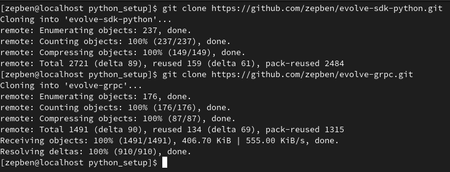
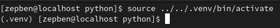
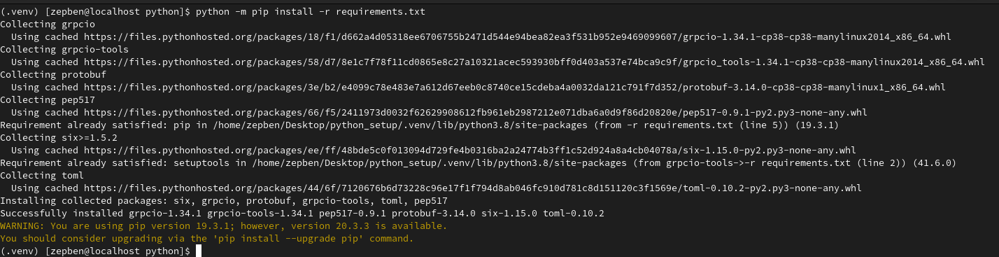
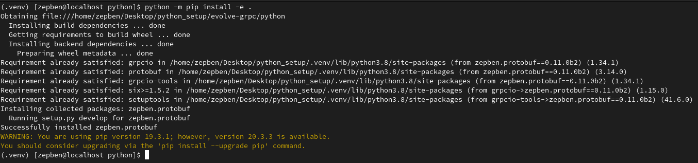
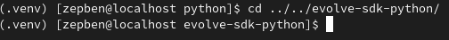
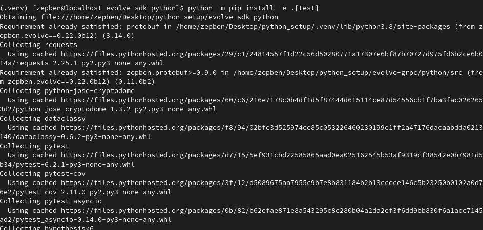
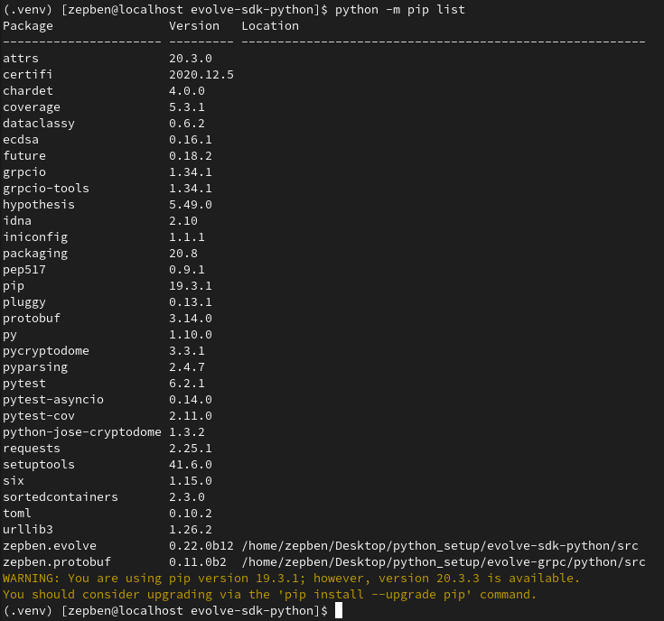

## Prerequisites
1. Python 3.7 or later

## Clone Git Repos
You will need to clone the following repos:
1. zepben/ewb-sdk-python
1. zepben/ewb-grpc

```bash
  git clone https://github.com/zepben/ewb-sdk-python.git
  git clone https://github.com/zepben/ewb-grpc.git
```



## Setup Virtual Environment
Once you have both repos create a virtual environment that will be shared between them. This will allow
you use the your local version of the ewb-grpc as a dependency for the ewb-sdk-python instead of having
to rely on the changes for the ewb-grpc to be finalised and deployed.

### ewb-grpc

1. Move to the ewb-grpc python directory and run the 'venv' python command to generate a virtual environment. This command will create a directory called .venv where all the files related to the virtual environment will be stored. Remember this directory as we will need it in the future whenever we want to reference this virtual environment.
```bash
  cd ewb-grpc/python/
  python -m venv ../../.venv
```

2. Activate the virtual environment you just created.
```bash
source ../../.venv/bin/activate
```


3. Install all packages required to build the ewb-grpc repo.
```bash
python -m pip install -r requirements.txt
```


4. Run the build.py script in ewb-grpc.
```bash
python build.py
```


5. Install the project in editable mode (this will allow you to use the ewb-grpc package locally)
```bash
python -m pip install -e .
```


### ewb-sdk-python

1. Move to the ewb-sdk-python root directory. (Make sure you are still using the same virtual environment)
```bash
cd ../../ewb-sdk-python/
```


2. Install the project in editable mode. This will be useful if we need to use the sdk in the future as a depencency. Note that for this command we also specify we require the test related packages.
```bash
python -m pip install -e .[test]
```


3. At this point you should have the virtual environment ready for both repos with all the required packages installed and the zepben.protobuf and zepben.ewb packages installed locally in editable mode. You can confirm this by running the following command:
```bash
python -m pip list
```

